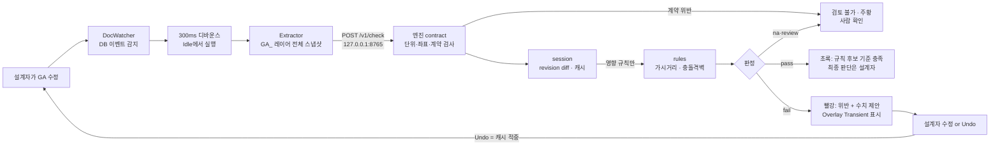

# 1차 멘토링 제출 자료 패키지

> 멘토 요청(2026-10-12 피드백): 샘플 GA 1건 · 두 규칙 수식과 원문 근거 · 24건 기대 결과표 · 현재 화면/흐름도 · 가장 막힌 질문 3개.
> 이 문서가 제출 묶음의 표지다. 각 자료의 위치·요약·남은 일을 모았다. (정리 기준일: 2026-10-13)

## 한눈에 — 자료 5종 준비 상태

| # | 자료 | 위치 | 상태 | 남은 일 | 담당 |
|---|---|---|---|---|---|
| 1 | 샘플 GA 1건 | `samples/S140_rev0_base.dxf` (+변경본 rev1~4) | 🟡 | 합성 도면 → 실제 GA 형식에 가깝게(레이어·치수·DWG). 공개 저장소이므로 공개 가능 도면만 | 표인범 |
| 2 | 두 규칙 수식·원문 근거 | `docs/rule-definitions.md` | 🟡 | 보유 SOLAS 통합본으로 판본 대조, MSC/Circ.982 조종위치 원문 확인 | 표인범 |
| 3 | 24건 기대 결과표 | `docs/test-cases.md` (원본 `engine/tests/cases/expected_24.json`) | 🟡 | **수기 재계산 후 `verified_by` 기입 — 현재 24건 전부 미기입** | 복준용 |
| 4 | 현재 화면/흐름도 | 화면: `samples/S140_report_example.html` (엔진 리포트) · 흐름도: 아래 초안 | 🟡 | AutoCAD 팔레트 실기 스크린샷(v0.3.2 빌드 후), Figma 흐름도 정식본 | 손종민 · 서용언 |
| 5 | 가장 막힌 질문 3개 | 아래 5장 (피드백 문서 4장 초안과 동일) | 🟡 | 팀 회의에서 확정 | 전원 |

멘토의 "1차에서 확인할 것" 5개 항목 ↔ 우리 대응 매핑은 `2026-10-12_1차-준비-피드백.md` 2장에 정리돼 있다.

---

## 1. 샘플 GA — S140 (합성, 140 m 일반화물선)

`samples/` 의 DXF 5개가 본선 데모 시나리오 순서 그대로다 (mm 단위, AP·기선 원점):

| 파일 | 상황 | 엔진 판정 |
|---|---|---|
| `S140_rev0_base.dxf` | 기준 상태 | 두 규칙 모두 기준 충족 |
| `S140_rev1_deck_containers.dxf` | 갑판 컨테이너 추가 | 가시거리 위반 (사각 433.84 m > 280 m) + 수치 제안 "x=112 m 상단을 z=22.45 m 이하로" |
| `S140_rev2_bulkhead_moved.dxf` | 충돌격벽 이동 | 격벽 위반 (11.00 m, 허용 6.60~10.56 m) |
| `S140_rev3_undo.dxf` | rev1로 Undo | 캐시 적중 (재계산 0건) |
| `S140_rev4_three_tiers.dxf` | 컨테이너 재배치 | 위반 해소 |

재현: `cd engine && python -m garc revs ../samples/S140_rev*.dxf`
주의: 합성 도면임을 멘토에게 먼저 말할 것. 실제형 GA(DWG) 1건은 2주차 목표.

## 2. 두 규칙 수식·원문 근거 — 요약

상세·원문 전문은 `docs/rule-definitions.md`. 멘토 미팅에서 바로 답할 수 있게 핵심만:

**두 규칙의 L이 다르다** — 가시거리 L = **LOA**(V/2.4), 충돌격벽 L = **ICLL 길이**(II-1/2). S140은 LOA 140 / L 132로 일부러 다르게 뒀다.

**R1 가시거리 (SOLAS V/22.1.1)**: 눈 E=(xe, ze)(선교 갑판 GA_EYE + 1.8 m), 수선 z = a + b·x (AP·FP 흘수 직선, 트림 반영).
사각 거리 D = max(x_hit) − x_bow, x_hit = xe + t·(xo − xe), t = (a + b·xe − ze)/((zo − ze) − b·(xo − xe)).
판정: D ≤ min(2·LOA, 500 m), **입력된 모든 흘수 조건 중 최악**, 경계 포함(1 µm 보정). 적용: LOA ≥ 55 m, 1998-07-01 이후 건조.

**R2 충돌격벽 (SOLAS II-1/12.1·12.3·12.4)**: min(0.05L, 10 m) ≤ d ≤ max(0.08L, 0.05L + 3 m).
d = x_ref − x_bhd. 구상선수가 FP 앞으로 나오면 기준점 x_ref = FP + min(돌출부 중점, 0.015L, 3 m) (셋 중 최소 측정). 계단·리세스는 전 구간이 허용 범위 안이어야 함. 상한 초과는 "주관청 허용 시 예외 가능 → 사람 확인" 문구 병기.

**다루지 않는 것(화면에 명시)**: 평면 ±10°·사각 섹터 각도(V/22.1.2), 흘수 조건이 "모든 적재 조건"을 대표하는지, 격벽 수밀 높이·상한 예외 승인.

⚠ 판본: 공개 IMO 문서·imorules 기준으로 작성됨. **팀 보유 통합본과 대조 전까지 '판본 확인 중'이라고 말할 것.**

## 3. 24건 기대 결과표 — 요약

표 전체는 `docs/test-cases.md` (자동 생성 — 고칠 땐 `expected_24.json` 수정 후 `python engine/scripts/render_cases.py`).

- 구성: 규칙당 12건 = 정상 3 + 경계 3 + 위반 3 + 누락 3 (합계 24: 정상 6·경계 6·위반 6·누락 6)
- 기대 판정 분포: pass 11 · fail 6 · na 4 · review 2 · skip 1
- 경계 케이스 포함: D=허용값 정확 일치(경계 포함 통과), LOA 55.0/54.99 적용 경계, 부동소수점(200.00000000000006) 보정
- 엔진 실측과 기대값 일치는 CI(`python -m unittest`, Python 3.10~3.14)로 매번 확인
- **빈 칸: `verified_by` 24건 전부 미기입.** 수기 계산 열은 Claude 초안이므로, 복준용이 손으로 재계산해 검증 열을 채워야 "수기 정답"이라고 말할 수 있다. 멘토링 전 최우선.

## 4. 현재 화면 · 흐름도

**화면(지금 보여줄 수 있는 것)**: 엔진 HTML 검토 리포트 — `samples/S140_report_example.html`을 브라우저로 열기. 요약 표, 측면도 SVG(시선·허용 한계선), 판정식·계산 중간값, 변경 이력, 면책 문구 포함.
**화면(미확보)**: AutoCAD 팔레트·오버레이 실기 스크린샷 — 플러그인 v0.3.2 재빌드와 첫 실행 확인표(`autocad/README.md`) 통과 후 캡처.

**흐름도 초안** (서용언 Figma 정식본 전까지 제출용):

핵심 설명 포인트: ① 판정은 엔진만(플러그인은 어댑터) ② 매번 전체 스냅샷, Undo는 캐시로 즉시 복귀 ③ 모르면 멈춘다 — na/review 하나라도 있으면 절대 초록 아님(엔진 연결 실패 포함).

## 5. 가장 막힌 질문 3개 (팀 확정 필요 — 초안)

1. **흘수 조건의 범위**: V/22는 "모든 흘수·트림·갑판화물 조건"인데, 기본설계 GA 단계에서 검토할 대표 조건을 무엇으로 잡는 게 실무적인가? (만재 출항 + 밸러스트 도착이면 충분한가, 적재지침서 조건을 다 넣어야 하나)
2. **조종위치·눈높이**: 실무에서 conning position을 GA의 어느 점으로 보나(선교 중앙 콘솔? 중심선?), 눈높이 1.8 m를 선교 갑판 기준으로 두는 게 맞나?
3. **측면도만으로 충분한가**: 좌우 10°·사각 섹터 각도는 평면도가 필요하다. 해커톤 범위에서 측면도 중심선 검토 + "평면 미검토" 명시로 가도 되는지, 평면 1개 규칙을 추가해야 설득력이 있는지.

(예비) 충돌격벽 L(ICLL 길이)을 도면에서 어떻게 받는 게 자연스러운가 — 설계자 직접 입력 vs 형심·수선에서 계산.

## 6. 발표 화면의 경계 문구 (멘토 당부 사항 → 이미 구현된 위치)

| 문구 | 구현 위치 |
|---|---|
| "규칙 엔진의 후보 판정입니다. 선급 승인이나 적합 증명이 아니며, 최종 판단은 설계자·선급 검토로 합니다." | 팔레트 상단 고정 + 모든 엔진 응답 `disclaimer_ko` + 리포트 하단 |
| 초록 상태: "규칙 후보 기준 충족 — 최종 판단은 설계자 검토" ('적합·승인·통과 확정' 미사용) | `engine.py` OVERALL_KO |
| "이 판정이 다루지 않는 것" 목록 (평면 10°, 사각 섹터, 수밀 높이 …) | 리포트 규칙별 근거 블록, 팔레트 규칙 카드 |
| 판정 = 결정론적 엔진 / AI = 설명만 / 사람 = 최종 검토 | 발표 슬라이드 1장 (4주차 제작) |

## 제출 전 체크리스트

- [ ] 복준용: 24건 수기 재계산 → `expected_24.json`의 `verified_by` 기입 → `render_cases.py` 재생성
- [ ] 표인범: SOLAS 판본 대조, MSC/Circ.982 조종위치 원문 확인 → `rule-definitions.md` 판본 칸 확정
- [ ] 손종민: 플러그인 v0.3.2 재빌드 + 첫 실행 확인표 → 팔레트 스크린샷을 이 문서 4장에 추가
- [ ] 서용언: 흐름도 Figma 정식본 (위 mermaid 초안 대체)
- [ ] 전원: 질문 3개 확정 (5장 초안에서)
- [ ] 샘플 GA 합성본임을 모두말에 명시하고 시연 (rev0→rev4)
